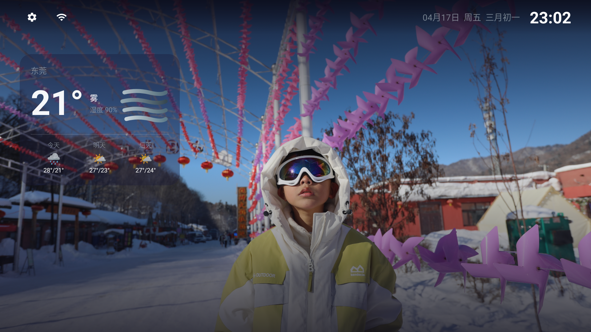
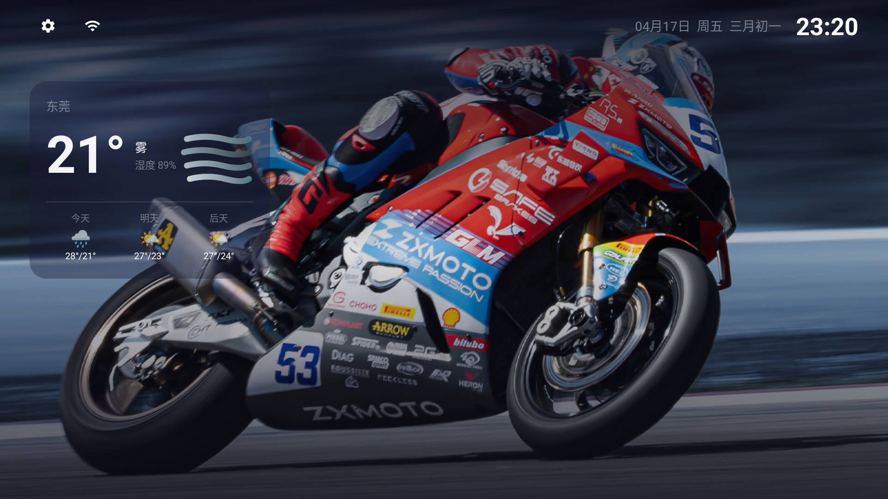
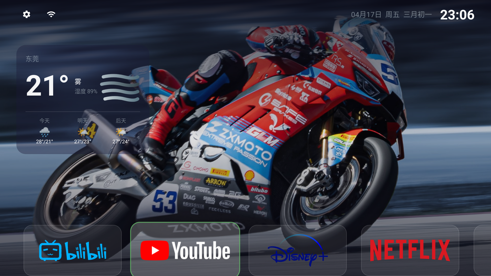
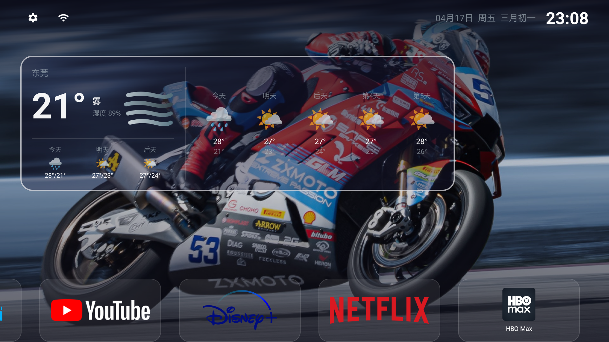
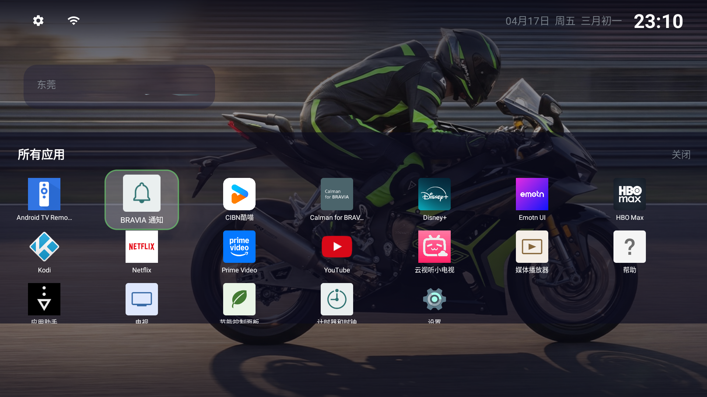
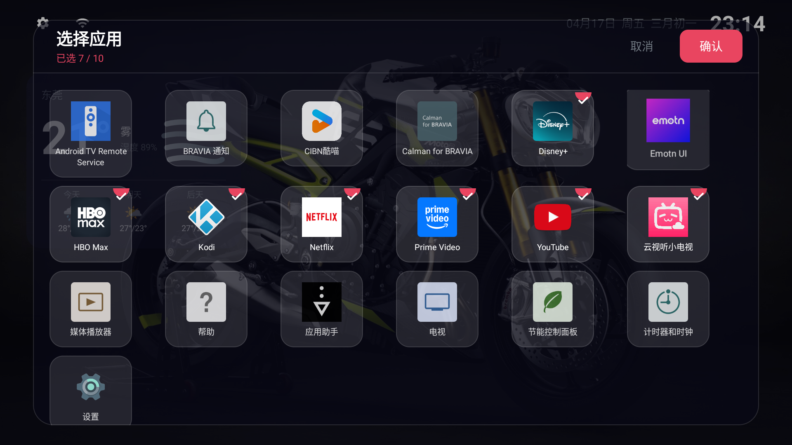
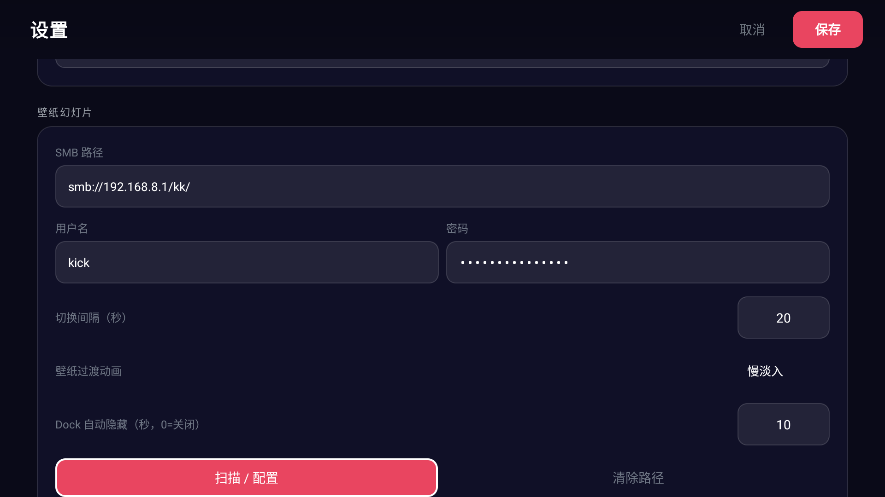

# KK TV Launcher

Android TV 桌面，版本 1.2.0。



界面实拍见 [`demo/README.md`](demo/README.md)。

## 开发目的

做一套可替换系统桌面的 Android TV 启动器，把壁纸、天气、底部应用栏、局域网投屏和桌面锁定放在同一个应用里，用遥控器完成日常操作。

## 需求

- 运行：Android TV，minSdk 26。已在 Android 12 电视上使用。
- 编译：JDK 17，compileSdk 35，Gradle 8.7。
- 发布签名：项目根目录 `signing.properties`（不提交）。
- 可选默认值：项目根目录 `local.properties`（不提交）。不配置时，安装后在设置里填写。

```properties
storeFile=your_keystore.jks
storePassword=your_store_password
keyAlias=your_key_alias
keyPassword=your_key_password
```

```properties
smb.dir=smb://192.168.x.x/share/
smb.user=your_smb_username
smb.pass=your_smb_password
weather.key=your_qweather_api_key
weather.city=北京
```

`local.properties` 里的 SMB 账号、密码和天气 Key 会编译进安装包。设置里如果存过空值，打开设置时仍显示这里的默认值。SMB 密码在设置界面为明文。

## 功能

- **壁纸**：内置图、本机图片、SMB、WebDAV、HTTP 目录。竖图左右拼接后铺满。可设置切换间隔和过渡动画。
- **天气**：和风天气。显示当前天气；卡片获得焦点后展开后续预报。
- **顶栏**：设置、WiFi、公历、星期、农历、时间。默认无焦点。
- **Dock**：底部快捷应用。优先使用透明 PNG，否则使用应用横幅。焦点放大，左右到边界后循环。可设置自动隐藏秒数，0 为不隐藏。
- **全部应用**：仅最右侧加号按下打开。网格内上下键按当前列换行。
- **投屏**：以 DLNA 媒体渲染器广播，设备名 `KK tvLuncher`。接收公开投屏视频，支持普通视频、FLV 和 HLS。播放失败时停留在提示，返回后回到桌面。另保留 `9978` 端口给相片查重。
- **锁定**：方向键密码锁定与解锁。可选每天定时锁定。锁定后界面保持原样，屏幕中央显示「已锁定」。电源键仍交给系统。
- **保活**：前台服务维持网络，熄屏后仍可调试连接。

## 使用

### 安装

```bash
git clone https://github.com/jeskick/com.kk.tvluncher.git
cd com.kk.tvluncher
./gradlew assembleRelease
adb install -r app/build/outputs/apk/release/app-release.apk
```

安装后在系统里将本应用设为桌面。

### 桌面

| 操作 | 结果 |
|------|------|
| 按一次 HOME | 切换下一张壁纸 |
| 短时间内再按一次 HOME | 显示 Dock |
| Dock 上按确定 | 打开该应用 |
| Dock 最右侧加号按下 | 打开全部应用 |
| 左右到 Dock 两端 | 从另一端继续 |
| 天气卡片获得焦点 | 展开预报 |
| 输入锁定密码 | 锁定或解锁 |

Dock 默认约 10 秒后隐藏。

### 设置

从顶栏进入设置。修改后选择保存。

| 项目 | 说明 |
|------|------|
| 桌面背景 | 查看当前来源。可选本机图片，或恢复内置壁纸 |
| 内置壁纸 | 随机切换，或固定一张 |
| 界面透明度 | 天气卡片等界面元素 |
| 焦点边框颜色 | 遥控器选中时的边框 |
| 城市 / 天气 Key | 和风天气 |
| SMB 路径 | 格式 `smb://地址/共享名/`。扫描后点选主机会写入此栏，共享名默认为 `kk` |
| SMB 用户名 / 密码 | 访问共享的账号。无密码的 Windows 共享通常无法访问 |
| 切换间隔 | 壁纸切换秒数 |
| 壁纸过渡 | 无动画或淡入 |
| Dock 自动隐藏 | 秒数。0 表示不隐藏 |
| 定时锁定 | 勾选后，每天到开始时间锁定，到结束时间解锁。默认 22:00–07:00，按整点调整。时段内用密码解锁后，保持解锁直到下一次跨越时间点。不勾选则不自动锁定，也不因此解除已有锁定 |
| 密码 | 方向键序列。默认「下 下 上 左 右」。在桌面输入完整序列锁定，再输入一次解锁。与定时开关无关。点「设置密码」后依次按方向键，确定保存，返回取消，最多 12 个键。输入中断超过约 4 秒则本次作废 |
| 系统设置 / WiFi 设置 | 打开系统对应页面 |

锁定期间，桌面、设置和选择应用页面不响应普通按键。电源键除外。

### 投屏

桌面进程运行后即可被局域网搜索，设备名为 **KK tvLuncher**。在手机投屏列表中选择该设备。播放页打开期间屏幕保持常亮，不按无操作进入休眠。关闭播放后恢复系统的休眠计时。

播放页：

| 操作 | 结果 |
|------|------|
| 上 / 下 | 上一个 / 下一个（相片查重换片） |
| 左 / 右 | 后退 / 前进 10 秒 |
| 确定 | 暂停或继续 |
| 返回 | 关闭播放 |

正在播放时快进或快退后继续播放。先暂停再快进，则停在新位置。画面左下角为 KK，底部为标题，视频右上角为码率。

相片查重使用同一台设备上的自定义接口：

- `GET http://<电视IP>:9978/cast/info`
- `POST http://<电视IP>:9978/cast/play`

### 自定义 Dock 图标

将透明 PNG 放到 `app/src/main/assets/icons/`，文件名为应用包名。

```
assets/icons/com.netflix.ninja.png
assets/icons/com.google.android.youtube.tv.png
assets/icons/com.xiaodianshi.tv.yst.png
assets/icons/org.smarttube.stable.png
assets/icons/com.cibn.tv.png
```

`org.smarttube.stable` 为 SmartTube。`com.cibn.tv` 为酷喵（优酷电视）。没有对应文件时，Dock 使用该应用自带横幅。

## 界面

| 场景 | 截图 |
|------|------|
| 默认桌面 |  |
| Dock |  |
| 天气展开 |  |
| 全部应用 |  |
| 选择 Dock 应用 |  |
| 设置 |  |

## License

MIT License
